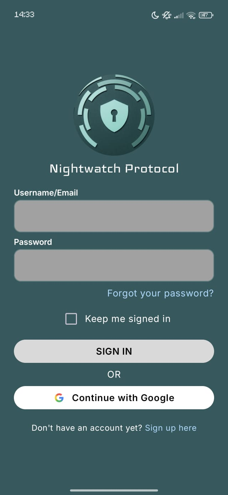
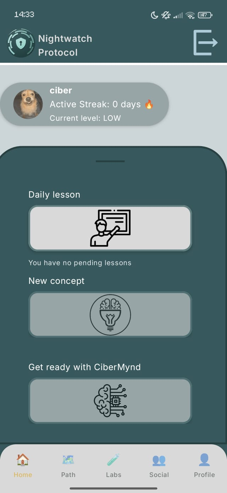
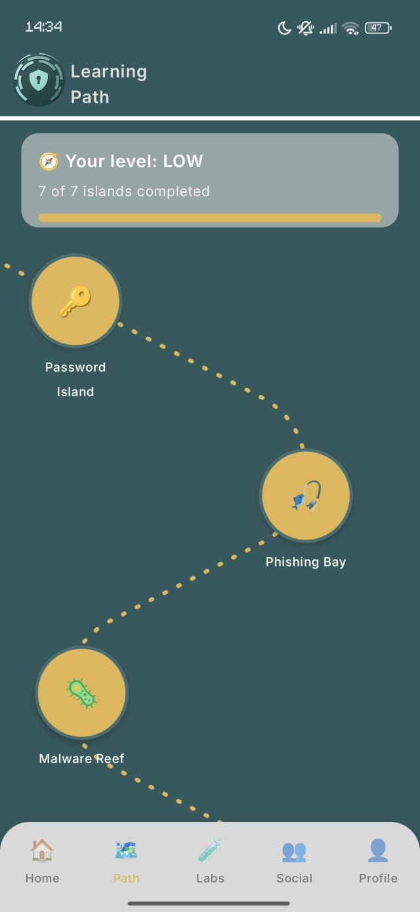
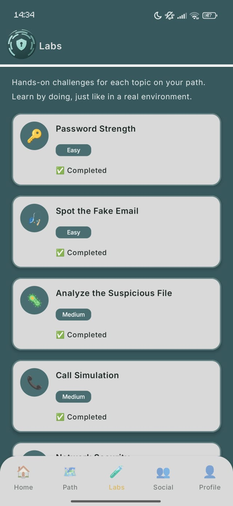
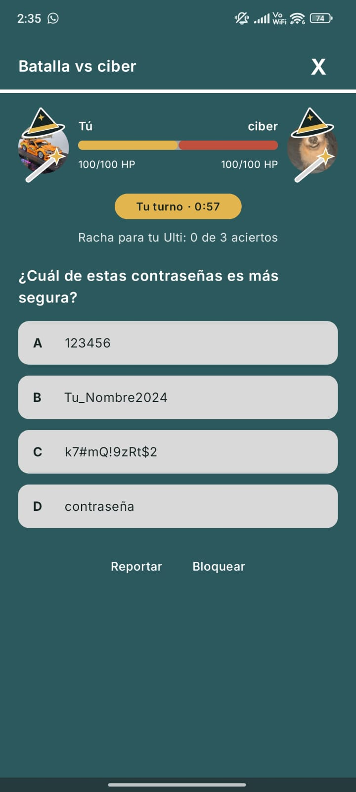
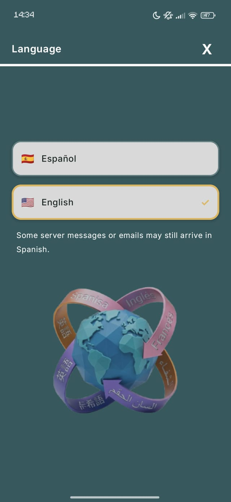
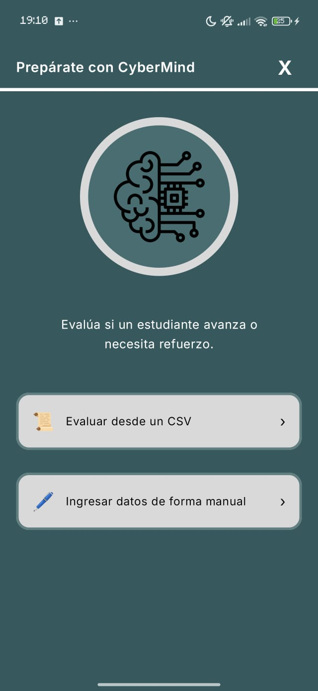
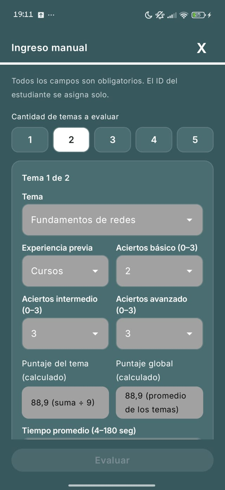
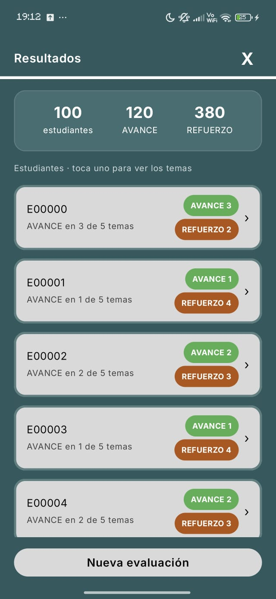
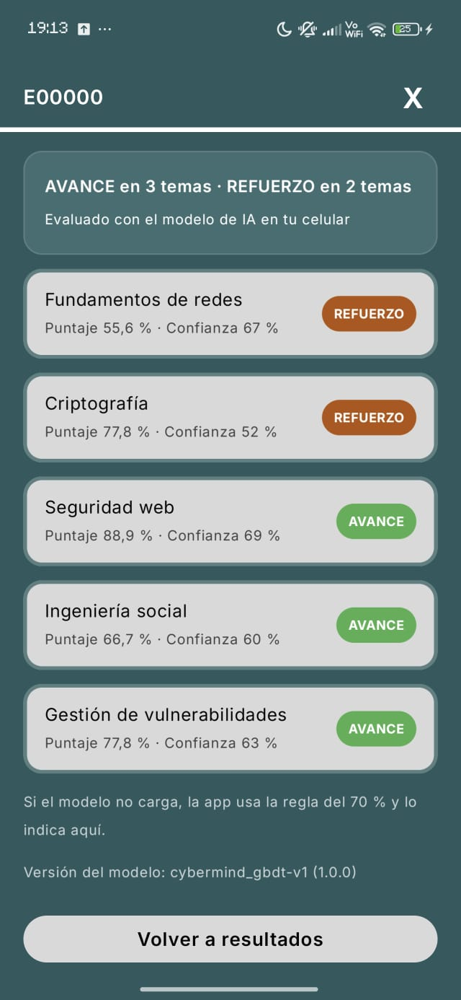

# NightWatch Protocol

Aplicación Android para aprender ciberseguridad con lecciones, laboratorios simulados, un examen final y batallas de preguntas con amigos.

**Versión actual: 2.5.0** (agrega el módulo de IA «Prepárate con CyberMind»). La **v2.4.0** (`versionCode` 7) es la entrega del curso *Android Basics with Compose* (módulos 1 a 5).

## Integrantes

- Nicolás Sotelo Caro
- David Alejandro Escobar Pasión
- Juan David Tellez Esquibel

Proyecto desarrollado por el equipo con apoyo de Claude Code (Anthropic) como asistente de programación. Las decisiones de diseño, la revisión del código y la integración las hizo el equipo mediante Pull Requests revisados.

Proyecto del curso *Android Basics with Compose*, cuyos patrones sigue (MVVM, `UiState`, `ViewModel`, inyección de dependencias manual) junto con el diseño de Figma del proyecto.

## Rama de la última versión funcional

**`main`**, marcada con la etiqueta **`v2.5.0`** (la entrega del curso de Android sigue marcada como `v2.4.0`). Es la rama de entrega y está protegida con una regla de GitHub: los cambios solo entran por Pull Request con al menos 1 aprobación de otro integrante (ver [Flujo de trabajo del equipo](#flujo-de-trabajo-del-equipo)).

## Qué hace la app

- **Cuenta:** registro con un código de 6 dígitos que llega al correo, inicio de sesión con correo o con Google, recuperación y cambio de contraseña, cambio de correo.
- **Quiz de nivelación:** al empezar, determina el nivel de la persona (BAJO, MEDIO o ALTO).
- **Ruta de aprendizaje:** un mapa de 6 islas (Contraseñas, Phishing, Malware, entre otras) y una prueba final. Cada isla tiene una lección y un laboratorio con una terminal simulada, y se desbloquean en orden.
- **Examen final:** 6 preguntas; se aprueba con 5 o más aciertos y no tiene límite de intentos.
- **Racha e insignias:** calculadas a partir del progreso guardado.
- **Social:** amigos (búsqueda por nombre de usuario o por código), racha en pareja, perfil social editable con fondo y foto, y reportar o bloquear personas.
- **Arena de batallas:** partida rápida o reto a un amigo, preguntas por turnos y «Ulti». El servidor decide aciertos, daño, turnos y plazos.
- **Perfil y ajustes:** nombre, género, fecha de nacimiento, foto, correo de recuperación, bloqueo biométrico, dispositivos con sesión abierta, descarga de los datos y recordatorios locales.
- **Apariencia:** tema claro, oscuro o automático.
- **Idioma:** español o inglés (interfaz, lecciones, labs, examen, quiz y preguntas de batalla).
- **Prepárate con CyberMind:** un modelo de IA que corre en el teléfono decide, por estudiante y tema, si avanza o necesita refuerzo (ver [la sección](#prepárate-con-cybermind-módulo-de-ia)).

Algunas cosas aún son solo visuales: Ayuda, Acerca de y los interruptores de notificaciones de «Logros» y «Nuevos laboratorios» (necesitarían notificaciones push).

## Capturas

| Inicio de sesión | Inicio | Ruta de aprendizaje |
|:---:|:---:|:---:|
|  |  |  |

| Laboratorios | Arena de batalla | Idioma |
|:---:|:---:|:---:|
|  |  |  |

## Prepárate con CyberMind (módulo de IA)

Dado el desempeño de un grupo de estudiantes en cinco temas de ciberseguridad, un **modelo de IA** decide para cada estudiante y tema si debe **AVANCE** (puede seguir adelante) o **REFUERZO** (necesita repasar). Se abre desde la tarjeta «Prepárate con CyberMind» de Inicio.

- **El modelo corre en el teléfono, sin internet.** Es un GBDT (árboles de decisión con gradiente) exportado a ONNX (`app/src/main/assets/cybermind_gbdt.onnx`) y ejecutado con ONNX Runtime. Muestra el resultado, la confianza y la versión del modelo (`cybermind_gbdt-v1`).
- **Plan B:** si el modelo no puede cargarse, la app usa la regla del 70 % (`puntaje_tema` de 70 o más avanza) y la pantalla lo indica; en ese caso no hay confianza, solo el puntaje.
- **Temas:** `fundamentos_redes`, `criptografia`, `seguridad_web`, `ingenieria_social` y `gestion_vulnerabilidades`.

**Cómo se usa**

1. **Archivo CSV.** Se descarga la plantilla desde la propia pantalla, se llena y se carga. Debe tener estas 9 columnas, en este orden: `id_estudiante`, `tema`, `experiencia_previa`, `aciertos_basico`, `aciertos_intermedio`, `aciertos_avanzado`, `puntaje_tema`, `puntaje_global`, `tiempo_promedio_seg`. Se rechaza si trae una columna `decision` (eso lo decide el modelo).
2. **Ingreso manual.** Se evalúa un estudiante con 1 a 5 temas. El ID, el `puntaje_tema` y el `puntaje_global` se calculan solos.

**Límites y reglas del CSV:** máximo 500 filas, 100 estudiantes y 200 KB. Se valida el archivo completo y, si algo falla, no se evalúa ninguna fila (la pantalla lista los primeros errores). Resumen de las reglas: valores dentro de los rangos y opciones permitidos; un tema no se repite por estudiante; `experiencia_previa` es la misma en todas las filas de un estudiante; `puntaje_tema` coincide con los aciertos; y, si el estudiante trae sus 5 temas, `puntaje_global` es el promedio de sus 5 `puntaje_tema` (tolerancia 0,1).

**Privacidad:** no se guarda ni se envía nada de los estudiantes; los resultados viven solo en memoria y se descartan al cerrar la pantalla. Los datos de ejemplo de CyberMind son 100 % sintéticos. Este módulo no usa Supabase.

**Repositorio del modelo y los experimentos de IA:** <https://github.com/CyberMind-UNI/CyberMind-ML> (ese repositorio enlaza de vuelta a este: <https://github.com/sotelocaronicolas-eng/nightwatch-protocol>).

**Tamaño:** por ONNX Runtime con varias arquitecturas el APK de depuración pesa unos 99 MB (el de la v2.4.0, 23,6 MB).

| Entrada | Ingreso manual | Resultados | Detalle |
|:---:|:---:|:---:|:---:|
|  |  |  |  |

## Cómo instalar la aplicación

La forma soportada de probar la app es el **APK de la pestaña Releases**, que ya viene configurado para conectarse al servidor del proyecto. La última versión es la **v2.5.0**; la **v2.4.0** es la entrega del curso de Android (módulos 1 a 5).

### Opción A (recomendada): instalar el APK en un teléfono Android

**Requisito:** Android 8.0 o superior y conexión a internet.

1. **Descarga el APK.** Desde el teléfono, abre la pestaña **Releases** del repositorio (<https://github.com/sotelocaronicolas-eng/nightwatch-protocol/releases>), entra a la versión **v2.5.0** (la última) y, en *Assets*, toca el archivo que termina en **`.apk`**.
2. **Permite instalar apps de origen desconocido.** Al abrir el archivo, Android avisará que el navegador (o el gestor de archivos) no puede instalar apps. Toca **Ajustes** en ese aviso y activa **Permitir desde esta fuente**. Si no aparece el aviso, busca en **Ajustes → Aplicaciones → Acceso especial → Instalar apps desconocidas** (o escribe «apps desconocidas» en el buscador de Ajustes) y activa el permiso para la app con la que descargaste el archivo. La ruta exacta cambia según la marca del teléfono.
3. **Instala.** Abre el `.apk` descargado (en la barra de notificaciones o en la carpeta *Descargas*) y toca **Instalar**.
4. **Primera apertura.** La app arranca en **español**. Regístrate o inicia sesión; el idioma y el tema (claro, oscuro o automático) se cambian en **Perfil → Ajustes**.
5. *(Opcional)* Después de instalar, puedes volver a desactivar el permiso de orígenes desconocidos.

**Posibles problemas**

| Problema | Qué hacer |
|---|---|
| Aviso de **Play Protect** («app no verificada» o «bloqueada») | La app no está en Google Play y por eso Play Protect la marca. Toca **Más detalles → Instalar de todos modos**. |
| **«App no instalada»** | Desinstala cualquier versión anterior de NightWatch Protocol, comprueba que el archivo se descargó completo (vuelve a descargarlo) y reintenta. |
| **Falta de espacio** | Libera algunos cientos de MB de almacenamiento e inténtalo de nuevo. |
| **«No compatible» o no se puede instalar** | La app necesita Android 8.0 o superior. Revisa la versión en **Ajustes → Acerca del teléfono**. |
| La app no deja iniciar sesión o dice que no hay conexión | Comprueba tu internet. El servidor usa un plan gratuito de Supabase que se pausa tras 7 días sin actividad; si sigue fallando, avisa al equipo para que lo reactive. |
| Los correos con códigos tardan o no llegan | Revisa la carpeta de spam (el remitente es una cuenta de Gmail enviada por Brevo). |

### Opción B: instalar en el emulador de Android Studio

1. En Android Studio, abre **Device Manager** y crea o inicia un emulador con **API 34 o 35**, imagen **Google APIs** (Google Play Services es necesario para el inicio de sesión con Google) y arquitectura **x86_64**.
2. Descarga el `.apk` de la versión v2.5.0 desde Releases en tu computadora.
3. **Arrastra el archivo `.apk` a la ventana del emulador**. Se instala solo y aparece en la lista de aplicaciones.

### Opción C: compilar desde el código (para revisarlo)

Esta opción es para quien quiera leer o modificar el código. **No es la forma soportada de probar la app.**

**Requisitos:** Android Studio reciente, JDK 25 para ejecutar Gradle (el proyecto lo declara en `gradle/gradle-daemon-jvm.properties` y Gradle puede descargarlo) y Android SDK 37.

1. Clona el repositorio y abre la carpeta en Android Studio.
2. Crea en la raíz un archivo **`local.properties`** copiando `local.properties.example`, con estas tres claves:
   ```
   SUPABASE_URL=<la URL del proyecto de Supabase>
   SUPABASE_PUBLISHABLE_KEY=<la clave publishable de Supabase>
   GOOGLE_WEB_CLIENT_ID=<el ID de cliente OAuth de tipo Web de Google>
   ```
3. Compila con:
   ```
   ./gradlew assembleDebug
   ```
   El APK queda en `app/build/outputs/apk/debug/`.

`local.properties` **no está en el repositorio por seguridad** (está en el `.gitignore`) y esos valores pertenecen al servidor del equipo, así que sin ellos la app compila pero se detiene al iniciar con un mensaje que dice qué clave falta. Por eso el APK de Releases es el camino para probar la app. Para el inicio de sesión con Google en una compilación propia además hay que registrar la huella SHA-1 del computador en Google Cloud (ver `docs/superpowers/supabase-configuracion.md`).

## Video tutorial de instalación

El video muestra la instalación del APK de la versión 2.4.0 (el procedimiento es el mismo para la 2.5.0) y un recorrido breve por la app.

[Ver el video de instalación en YouTube](https://youtu.be/nQ3FZVkF3bM)

## Tecnologías y arquitectura

| Área | Qué se usa |
|---|---|
| Lenguaje | Kotlin 2.2.10 |
| Interfaz | Jetpack Compose (BOM 2026.02.01) con Material 3 |
| Arquitectura | MVVM: pantalla con estado + `ViewModel` con `StateFlow<UiState>` inmutable y eventos de una sola vez por `Channel`; repositorios con interfaz y *fakes* para las pruebas; inyección de dependencias manual en `AppContainer` (sin Hilt) |
| Navegación | Navigation Compose 2.9.7 con rutas tipadas `@Serializable` |
| Backend | **Supabase** (supabase-kt 3.2.4, Ktor 3.3.0): Auth (correo, Google, códigos de un solo uso), Postgres con RLS, Storage (fotos) y Edge Functions (código del correo de recuperación) |
| Correos | Brevo: SMTP para los correos de Auth y API para la Edge Function |
| Inicio de sesión con Google | Credential Manager 1.5.0 + `googleid` 1.1.1 |
| Preferencias locales | DataStore 1.2.1 (tema y otras preferencias) |
| Segundo plano | WorkManager 2.12.0 (recordatorios locales) |
| Biometría | `androidx.biometric` 1.1.0 |
| Idiomas | Recursos `values/` (español) y `values-en/` (inglés) con AppCompat 1.8.0; contenido de lecciones en `assets/content/es/` y `assets/content/en/` |
| IA en el teléfono | ONNX Runtime Android 1.20.0 con un modelo GBDT (`cybermind_gbdt.onnx`) |
| Serialización | kotlinx.serialization 1.8.0 |
| Pruebas | JUnit 4, Turbine 1.2.1, `kotlinx-coroutines-test`, Compose UI Test |
| Compilación | Android Gradle Plugin 9.3.3, Gradle 9.5.0 (wrapper incluido), `minSdk` 26, `compileSdk` y `targetSdk` 37 |

```
Pantalla (Compose)  →  ViewModel (UiState + eventos)  →  Repositorio (interfaz)  →  Supabase
       ▲                                                        │
       └──────────── UiState (StateFlow) ◄──────────────────────┘
```

- Las pantallas y los ViewModels solo conocen interfaces; solo `di/AppContainer` y las clases `Supabase*` conocen la librería.
- La fila de cada persona se identifica siempre por la sesión, nunca por un dato de la pantalla. La seguridad real está en la base de datos (RLS y privilegios mínimos).
- El progreso de la ruta se guarda en tres tablas y todo lo demás (islas, desbloqueo, racha, insignias) se calcula de ahí con funciones puras.
- En Social, el servidor decide todo el juego; la app consulta el estado cada 2 a 3 segundos mientras la arena está visible.

## Calidad

```
./gradlew assembleDebug testDebugUnitTest lintDebug
```

La versión 2.5.0 tiene **1625 pruebas unitarias, 0 fallos, 0 omitidas (100 % exitosas)**, verificado con `./gradlew testDebugUnitTest` (la 2.4.0 tenía 1526; informe de Gradle en `app/build/reports/tests/testDebugUnitTest/index.html`, que no se versiona). Hay además pruebas que vigilan que no queden colores fijos fuera del tema, que los textos en español e inglés tengan los mismos recursos y que el contenido de ambos idiomas tenga la misma estructura.

## Estructura del repositorio y documentación

```
NightWatchProtocol/
├── app/src/main/           # código (java/.../data, ui, di, cybermind), recursos (res/values, res/values-en) y contenido (assets/content/es y en)
├── app/src/test/           # pruebas unitarias
├── app/src/androidTest/    # pruebas instrumentadas
├── supabase/
│   ├── migrations/         # 0001 a 0013: SQL que se ejecuta a mano, en orden y una sola vez
│   ├── rollback/           # reversa de la migración 0013
│   ├── verificacion/       # guiones de comprobación (no son migraciones)
│   └── functions/send-recovery-email-code/   # Edge Function (Deno/TypeScript) y su README
├── docs/
│   ├── screenshots/        # capturas de este README
│   └── superpowers/
│       ├── specs/          # diseños de cada módulo
│       ├── plans/          # planes (los de los módulos 1 y 2 son históricos)
│       ├── reports/        # informes de cierre, verificación, revisión de código y auditoría de secretos
│       ├── translations/   # tablas de revisión de las traducciones (UI y contenido)
│       └── supabase-configuracion.md   # ajustes del panel, flujos y limitaciones
├── local.properties.example  # plantilla (el archivo real no se versiona)
└── gradle/libs.versions.toml # catálogo de versiones
```

Documentos para empezar: [`docs/superpowers/supabase-configuracion.md`](docs/superpowers/supabase-configuracion.md), la spec del módulo 5 en [`docs/superpowers/specs/2026-11-02-modulo-5-personalizacion-design.md`](docs/superpowers/specs/2026-11-02-modulo-5-personalizacion-design.md), el informe del módulo 4 en [`docs/superpowers/reports/modulo-4-informe.md`](docs/superpowers/reports/modulo-4-informe.md), el informe del módulo de IA en [`docs/superpowers/reports/modulo-ia-cybermind.md`](docs/superpowers/reports/modulo-ia-cybermind.md) y la [auditoría de secretos](docs/superpowers/reports/auditoria-secretos-entrega.md).

La base de datos y la Edge Function **se despliegan a mano** desde el panel de Supabase. Una migración ya aplicada no se edita: un cambio va en una migración nueva.

## Flujo de trabajo del equipo

- Una rama por tarea; un commit por etapa o por tema.
- Todo entra a `main` por Pull Request con **1 aprobación** de otro integrante, usando **«Create a merge commit»**.
- Nunca se usa `git push --force` y `local.properties` nunca se sube.
- Cada versión se marca con una etiqueta `vX.Y.Z` y un Release (el último es `v2.5.0`).
- No se actualizan AGP, Gradle, Kotlin, supabase-kt ni Ktor sin acuerdo previo del equipo.

## Limitaciones conocidas

- El servidor usa planes gratuitos: Supabase pausa el proyecto tras 7 días sin actividad y Brevo permite unos 300 correos al día.
- No hay modo sin conexión: guardar sin internet falla con un aviso (el informe del lab y el resultado del examen ofrecen «Reintentar guardado»).
- El examen se corrige en el teléfono y no hay pantalla de moderación (los reportes los revisa el equipo en el panel de Supabase).
